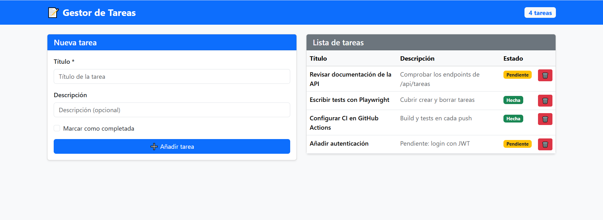
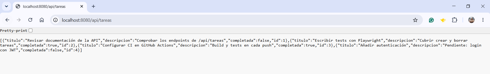

# Gestor de Tareas


Aplicación web para gestionar tareas: se pueden crear, consultar y borrar, y marcarlas como pendientes o hechas. Es un proyecto de clase del ciclo de Desarrollo de Aplicaciones Multiplataforma (DAM) en el que monté el stack completo: API REST en Java, frontend en React, base de datos PostgreSQL, contenedores con Docker, pruebas automáticas e integración continua.



## Tecnologías

| Capa | Tecnología |
|---|---|
| Backend | Java 21, Spring Boot 4, Spring Data JPA, Hibernate |
| Base de datos | PostgreSQL 15 |
| Frontend | React 19, Vite 7, Bootstrap |
| Pruebas | JUnit y Maven (backend), Vitest (frontend), Playwright (end-to-end) |
| Infraestructura | Docker y Docker Compose, GitHub Actions |

## Estructura del repositorio

```
gestor-tareas/
├── backend/    API REST (Spring Boot), Dockerfile y docker-compose.yml
├── frontend/   Interfaz (React + Vite) y pruebas e2e con Playwright
└── .github/    Workflow de integración continua
```

## Cómo ejecutarlo en local

Necesitas tener instalados Docker Desktop y Node.js (22 o superior).

**1. Backend y base de datos** (desde la carpeta `backend`):

```bash
docker compose up --build
```

Esto levanta PostgreSQL y la API. Cuando aparezca `Started GestorTareasApplication`, la API responde en `http://localhost:8080/api/tareas`.



**2. Frontend** (desde la carpeta `frontend`, en otra terminal):

```bash
npm install
npm run dev
```

La aplicación queda disponible en `http://localhost:3000`.

## API

La API REST trabaja sobre el recurso `/api/tareas`. Cada tarea tiene `id`, `titulo`, `descripcion` y `completada`:

```json
{ "id": 1, "titulo": "Revisar documentación de la API", "descripcion": "Comprobar los endpoints de /api/tareas", "completada": false }
```

## Pruebas

```bash
# Backend (desde backend/)
./mvnw verify

# Frontend, pruebas unitarias (desde frontend/)
npx vitest run

# Frontend, pruebas end-to-end (desde frontend/)
npx playwright test
```

## Integración continua

El workflow de GitHub Actions (`.github/workflows/ci.yml`) se ejecuta en cada push y pull request a `main`:

- **backend:** compila y pasa los tests con Maven.
- **frontend:** instala dependencias, ejecuta los tests de Vitest y comprueba que el build funciona.
- **docker:** construye la imagen del backend para verificar que el Dockerfile es correcto.

Las pruebas end-to-end con Playwright se ejecutan en local, todavía no forman parte del CI.

## Despliegue

En su día desplegué el proyecto en Railway con su periodo de prueba. Ese periodo terminó, así que ya no hay demo pública. La aplicación se puede levantar en local con Docker en un par de comandos, como se explica arriba. Para producción, el backend usa el perfil `prod` y se configura por variables de entorno (`SPRING_DATASOURCE_URL`, `PGUSER`, `PGPASSWORD`, `FRONTEND_URL`, `PORT`).

## Próximos pasos

- Autenticación de usuarios (por ejemplo con JWT).
- Editar tareas desde la interfaz.
- Incluir las pruebas end-to-end en el pipeline de CI.

## Autora

Denitsa Mutlova · [LinkedIn](https://linkedin.com/in/denitsa-mutlova-6a43a8143) · [GitHub](https://github.com/Denitsa-Mutlova)
